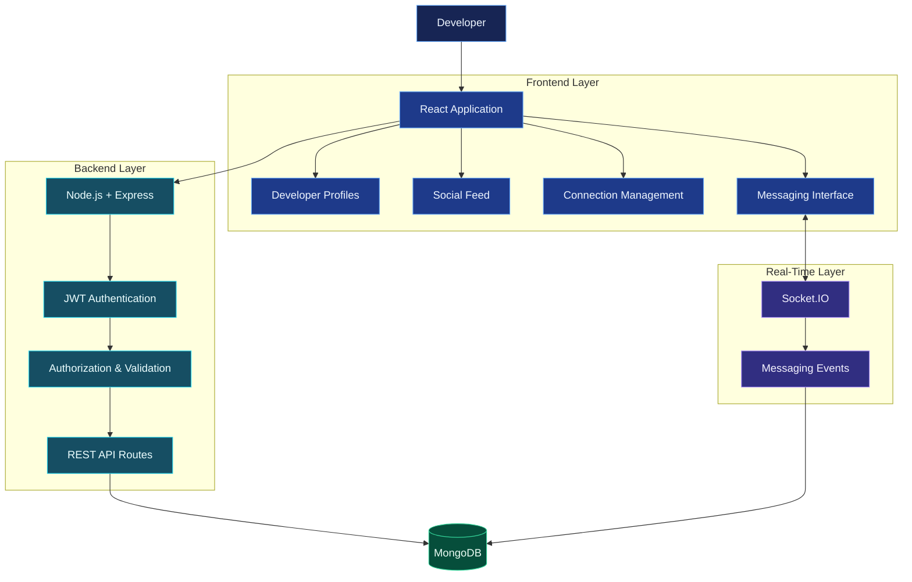
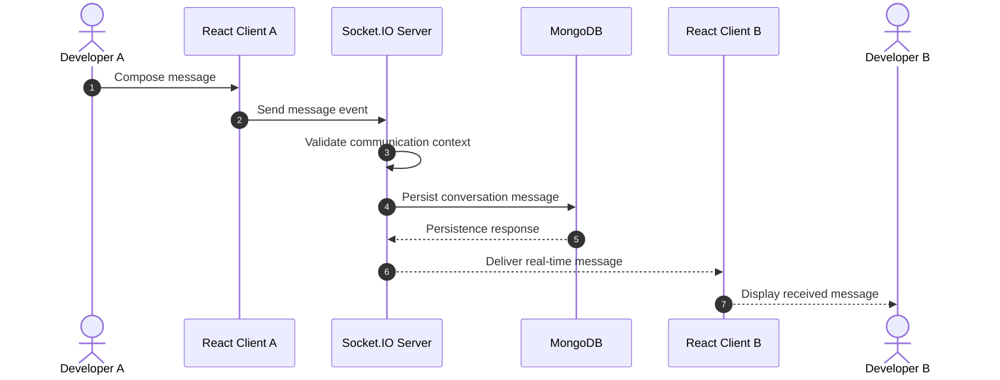

# 💻 Developer Networking Platform
### Connect. Collaborate. Communicate.

<p align="center">
  
</p>

<p align="center">
  
  
  
  
  
</p>

<p align="center">
  <b>A full-stack developer networking platform designed to bring developers together through professional profiles, connection requests, social feeds, and real-time messaging.</b>
</p>

<p align="center">
  <a href="#-overview">Overview</a> •
  <a href="#-architecture">Architecture</a> •
  <a href="#-features">Features</a> •
  <a href="#-real-time-messaging">Real-Time Messaging</a> •
  <a href="#-technology">Technology</a> •
  <a href="#-setup">Setup</a>
</p>

---

## `~/overview` — The Idea

Developers need more than a place to display their technical skills. They need a space where they can discover other developers, build professional connections, share updates, and communicate.

The **Developer Networking Platform** is a full-stack web application built to support these interactions through a centralized networking experience.

It combines traditional REST-based application workflows with real-time communication using Socket.IO.

### Project Highlights

| Metric / Capability | Details |
|---|---|
| Simulated users | 100+ |
| REST APIs | 13+ |
| Real-time communication | Socket.IO |
| Authentication | JWT |
| Password security | bcrypt |
| Database | MongoDB |
| Query optimization | Indexing and aggregation pipelines |
| API response improvement | Approximately 30% |
| Frontend | React.js |
| Backend | Node.js and Express.js |

---

## `~/architecture` — System Architecture

The application follows a client-server architecture. React handles the user interface, Express provides REST APIs, MongoDB manages persistent application data, and Socket.IO enables real-time messaging.



### Architecture Responsibilities

| Layer | Responsibility |
|---|---|
| React | User interface and client-side interactions |
| Node.js | Backend runtime |
| Express.js | REST API development and request handling |
| JWT | Authentication |
| bcrypt | Secure password hashing |
| MongoDB | Persistent application data |
| Socket.IO | Real-time messaging |

---

## `~/features` — Core Functionality

### 01 / Developer Profiles

A networking experience starts with developer identity.

- Developer profile creation and management.
- Profile information accessible through the application.
- Foundation for discovering and connecting with other developers.

### 02 / Connection Management

Build a professional developer network.

- Send connection requests.
- Manage connection workflows.
- Support interactions between simulated users.

### 03 / Social Feed

A shared space for developer activity.

- Feed-related REST API functionality.
- Centralized access to networking content.
- Integration with the platform's backend workflows.

### 04 / Real-Time Messaging

Communication without waiting for page refreshes.

- Socket.IO integration.
- Instant message delivery.
- Persistent conversation storage.

### 05 / Secure Authentication

Security is integrated into the backend application.

- JWT-based authentication.
- Protected application routes.
- bcrypt password hashing.
- Input validation.

---

## `~/api_design` — Backend Engineering

The platform includes **13+ RESTful APIs** supporting its main application workflows.

### API Responsibility Map

| API Domain | Responsibility |
|---|---|
| Authentication | User authentication and access |
| Profiles | Developer profile management |
| Feed | Feed-related application operations |
| Connections | Connection request workflows |
| Messaging | Conversation-related operations |

*Exact HTTP methods, route paths, request schemas, and response formats should be documented from the implemented Express routes.*

---

## `~/realtime_messaging` — Socket.IO

Real-time communication is one of the key engineering components of this project.

Traditional HTTP requests follow a request-response pattern. Socket.IO introduces event-driven communication, allowing connected clients to exchange messages without repeatedly polling the server.

### Conceptual Messaging Workflow



*The sequence describes the intended messaging responsibility. Exact event names, acknowledgement behavior, and delivery guarantees depend on the implementation.*

### Why Socket.IO?

- Supports bidirectional event-based communication.
- Avoids repeatedly refreshing the messaging interface.
- Provides a dedicated communication layer alongside REST APIs.
- Supports interactive conversations between connected developers.

---

## `~/database` — Data Management

MongoDB is used as the application's database.

The project also incorporates database query optimization through:

- Indexing.
- Aggregation pipelines.
- Efficient retrieval of application data.

### Query Optimization

Database performance becomes increasingly important as the number of users and stored records grows.

The project involved optimizing MongoDB queries using indexing and aggregation pipelines, resulting in an approximately **30% reduction in average API response time**.

The comparison methodology and benchmark conditions should be documented alongside the source code if you want to present this metric as a reproducible performance result.

---

## `~/security` — Authentication & Protection

| Mechanism | Purpose |
|---|---|
| JWT | Token-based authentication |
| bcrypt | Password hashing |
| Route protection | Restrict access to protected resources |
| Input validation | Validate incoming application data |
| Backend authorization | Enforce access permissions server-side |

### Security Principles

- Passwords should never be stored in plaintext.
- Authentication secrets should be stored in environment variables.
- Protected operations should be validated on the backend.
- Sensitive tokens should not be exposed in application logs.
- Client-side checks should not replace backend authorization.

---

## `~/technology` — Tech Stack

<p align="center">
  
</p>

| Category | Technology |
|---|---|
| Frontend | React.js |
| Backend | Node.js |
| Framework | Express.js |
| Database | MongoDB |
| Real-Time Communication | Socket.IO |
| Authentication | JSON Web Tokens |
| Password Hashing | bcrypt |
| API Communication | REST APIs, AJAX |
| Database Optimization | Indexing, Aggregation Pipelines |
| Version Control | Git, GitHub |

---

## `~/engineering_decisions` — Design Choices

| Engineering Choice | Reason |
|---|---|
| MERN stack | JavaScript-based full-stack development |
| REST APIs | Structured communication between frontend and backend |
| MongoDB | Flexible document-oriented persistence |
| Socket.IO | Real-time messaging |
| JWT | Stateless token-based authentication |
| bcrypt | Secure password hashing |
| Indexing | Improve database query performance |
| Aggregation | Support structured data processing |

---

## `~/setup` — Getting Started

The following is a setup template. Adjust directory names and environment variables to match the actual repository before publishing.

### Prerequisites

- Node.js
- npm
- MongoDB
- Git

### 01 / Clone the Repository

```bash
git clone https://github.com/Sarthaktanpure/Developer-Networking-Platform.git

cd Developer-Networking-Platform
```

### 02 / Install Dependencies

Navigate to the backend directory:

```bash
cd <BACKEND_DIRECTORY>
npm install
```

Navigate to the frontend directory in a separate terminal:

```bash
cd <FRONTEND_DIRECTORY>
npm install
```

### 03 / Configure Environment Variables

Create the backend `.env` file using the variable names expected by your application.

Example configuration:

```env
PORT=<BACKEND_PORT>
MONGODB_URI=<YOUR_MONGODB_CONNECTION_STRING>
JWT_SECRET=<YOUR_JWT_SECRET>
```

If the frontend requires a backend API URL, configure it using the environment-variable convention supported by your frontend build tool.

### 04 / Start the Application

Start the backend using its configured npm script:

```bash
npm start
```

Start the frontend:

```bash
npm run dev
```

Open the frontend's local development URL in your browser.

---

## `~/roadmap` — Future Improvements

Potential improvements for the platform:

- [ ] Developer search and advanced filtering.
- [ ] Personalized developer recommendations.
- [ ] Improved notification experience.
- [ ] Message read receipts and delivery indicators.
- [ ] Online presence and typing indicators.
- [ ] Profile verification.
- [ ] Automated API and integration testing.
- [ ] Improved application observability.
- [ ] Performance testing with larger user populations.

*These are proposed enhancements, not claims about currently implemented functionality.*

---

## `~/project_metrics` — Development Summary

| Area | Project Work |
|---|---|
| Full-stack development | React + Node.js + Express |
| Backend engineering | 13+ REST APIs |
| Authentication | JWT and bcrypt |
| Database | MongoDB |
| Real-time systems | Socket.IO messaging |
| Query optimization | Indexing and aggregation |
| Performance | Approximately 30% lower average API response time |
| Testing scale | 100+ simulated users |

---

## `~/author` — About the Developer

**Sarthak Tanpure**  
B.E. Information Technology  
Pravara Rural Engineering College

Interested in Software Engineering, Backend Development, Distributed Systems, and AI-powered applications.

<p align="center">
  <a href="https://github.com/Sarthaktanpure">
    
  </a>
  <a href="https://www.linkedin.com/in/sarthak-tanpure-a74b5133a/">
    
  </a>
</p>

<p align="center">
  <b>Built to connect developers. Designed to make collaboration easier.</b>
</p>

<p align="center">
  
</p>